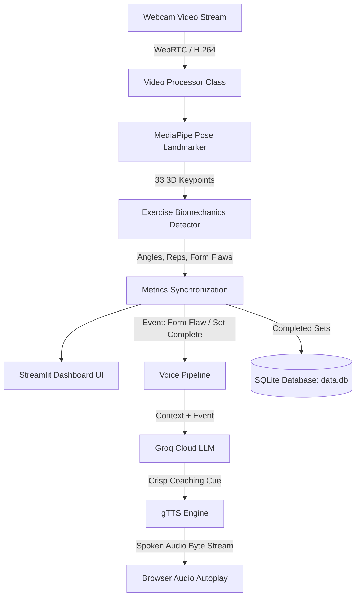

# VisionFit 🏋️‍♂️ — Real-Time AI Gym Coach & Form Corrector

[](https://streamlit.io/)
[](https://www.python.org/)
[](https://developers.google.com/mediapipe)
[](https://opencv.org/)
[](https://groq.com/)
[](https://www.docker.com/)

> **Your form. Analyzed. Corrected. In milliseconds.**  
> VisionFit is an intelligent real-time personal fitness coach that uses computer vision to track body landmarks, validate biomechanical angles, count repetitions, and provide **instant proactive voice coaching cues** powered by Groq and AI Text-to-Speech.

---

## 🌟 Key Features

- **🎥 Real-Time WebRTC Computer Vision**: Ultra-low latency camera streaming using `streamlit-webrtc` and Google MediaPipe Pose Landmark Detection.
- **🏋️ Multi-Exercise Biomechanics**:
  - **Squats**: Rep counts only when the knee bends past 100°; shallow reps are flagged (*"TOO HIGH"*), plus torso-lean check.
  - **Push-ups**: Elbow flexion angles, spine & hip alignment (*"SAGGING"*, *"PIKED UP"*).
  - **Biceps Curls**: Arm range-of-motion, elbow drift detection, torso swing prevention.
  - **Shoulder Press**: Overhead extension check, lower-back arch monitoring.
  - **Lunges**: Front knee flexion, torso posture, and balance stability checks.
- **🎬 Video analysis**: Upload a clip and get it back with the skeleton drawn on, a joint-angle chart with every rep marked, a 0–100 score per rep (form flags, depth margin, tempo), and a still of the rep that needs the most work.
- **🌐 Live demo in the browser**: The landing page runs MediaPipe pose tracking entirely client-side, using a JavaScript port of the detectors that is tested frame-by-frame against the Python versions. No server, no upload, no cold start.
- **🎨 Clean athletic UI**: Light theme, live rep counter and set progress next to the camera, form status chips, and a coach card — works on phones too.
- **⚡ Smooth live updates**: The live panel refreshes in a `st.fragment` and voice cues are generated on a background thread, so the page never freezes while the coach is "thinking".
- **🤖 Proactive AI Voice Coaching (Groq)**:
  - Generates crisp, high-energy coaching cues (10–15 words) tailored to real-time form flaws.
  - Powered by Groq's high-speed inference engine (`openai/gpt-oss-20b` / `groq/compound-mini`) with hidden reasoning mode for sub-second responses.
- **🗣️ Audio Voice Feedback (TTS)**: Converts coach cues to spoken audio that plays automatically during your workout.
- **📈 Rep Counting & Progress Tracking**: Automatic repetition counting per set and target-set tracking; counts survive a camera restart and stop at your target.
- **📊 Workout History**: Per-day logs of exercise, reps, sets and time, plus "this week" totals.
- **🌐 Landing Page**: A static HTML/CSS/JS page (in `LandingPage/`) with an interactive stick-figure preview that runs the same thresholds as the real detectors.

---

## 🏗️ System Architecture



---

## 📁 Repository Structure

```text
VisionFit-/
├── Dockerfile                  # Production container definition (Python 3.12-slim)
├── .dockerignore               # Docker ignore rules
├── .gitignore                  # Git exclusions (protects .env & secrets.toml)
├── .env.example                # Environment variable reference template
├── packages.txt                # Linux apt-get packages for Streamlit Cloud (libgl1)
├── requirements.txt            # Python dependencies (Streamlit, OpenCV, MediaPipe, Groq)
├── README.md                   # Project documentation
│
├── .streamlit/config.toml      # App theme (colours, Google Fonts), toolbar and upload settings
├── tests/                      # pytest suite + JS parity tests + shared pose fixtures
├── scripts/benchmark.py        # Rep-counting accuracy benchmark on labelled clips
├── benchmarks/                 # Benchmark labels, results, how to record clips
├── docs/build-notes/           # Step-by-step notes written while building the app
│
├── LandingPage/                # Static landing page (deployed on Vercel)
│   ├── index.html              # Page markup
│   ├── style.css               # Light "clean athletic" styling
│   ├── app.js                  # Nav + exercise simulator
│   ├── detectors.js            # JS port of the rep detectors (parity-tested)
│   ├── live.js                 # In-browser MediaPipe live demo
│   ├── favicon.svg             # Site icon
│   ├── IMGs_add_your_own/      # Drop real app screenshots here
│   └── videos_add_your_own/    # Drop real demo clips here
│
└── app/                        # Core Streamlit Application
    ├── main.py                 # Streamlit entry point
    ├── requirements.txt        # Sub-directory dependencies
    ├── packages.txt            # System dependencies
    ├── core/                   # Mathematical calculations & angle geometry
    ├── detectors/              # Per-exercise angle detectors (squat, pushup, etc.)
    ├── samples/                # Optional demo clips for the "Try the sample clip" button
    ├── ml_models/              # MediaPipe Pose Landmarker task model
    ├── services/
    │   ├── analysis/           # Offline video analyzer + per-rep scoring report
    │   ├── auth/               # User session & login wall
    │   ├── coaching/           # LLMCoach (Groq) & TTS voice pipeline
    │   ├── config/             # Workout parameters & system prompts
    │   ├── persistence/        # SQLite exercise repository
    │   ├── tracking/           # Metric sync & rep tracking logic
    │   ├── ui/                 # HTML components, CSS loader & WebRTC button styling
    │   └── vision/             # WebRTC video frame processing pipeline
    └── static/                 # App stylesheet
```

---

## 🚀 Quick Start (Local Setup)

### 1. Prerequisites
- **Python 3.12** is recommended (MediaPipe binary wheels support Python 3.12).
- Webcam connected.
- A free [Groq API Key](https://console.groq.com/keys).

### 2. Clone the Repository
```bash
git clone https://github.com/SAHIL-AGARWAL-IN/VisionFit-.git
cd VisionFit-
```

### 3. Set Up a Virtual Environment
```bash
# Windows
py -3.12 -m venv venv
.\venv\Scripts\activate

# Linux / macOS
python3.12 -m venv venv
source venv/bin/activate
```

### 4. Install Dependencies
```bash
pip install -r requirements.txt
```

### 5. Configure API Keys
Create a `.env` file in the root directory (or copy `.env.example`):
```bash
cp .env.example .env
```
Edit `.env` with your Groq API key:
```env
GROQ_API_KEY=gsk_your_groq_api_key_here
```

### 6. Run the Application
```bash
streamlit run app/main.py
```
The app will automatically launch at **`http://localhost:8501`**.

---

## ☁️ Deployment Guide

### Method 1: Streamlit Community Cloud *(Free & Recommended)*

1. Push your repository to GitHub.
2. Go to [share.streamlit.io](https://share.streamlit.io) and log in with GitHub.
3. Click **"New app"** and configure:
   - **Repository:** `SAHIL-AGARWAL-IN/VisionFit-`
   - **Branch:** `main`
   - **Main file path:** `app/main.py`
4. Expand **Advanced settings** ➔ **Secrets**, and paste:
   ```toml
   GROQ_API_KEY = "your_groq_api_key_here"
   ```
5. *(Optional WebRTC TURN config for strict firewalls):*
   ```toml
   [rtc_configuration]
   iceServers = [
     { urls = ["stun:stun.l.google.com:19302", "stun:stun1.l.google.com:19302"] }
   ]
   ```
6. Click **Deploy!**

---

### Method 2: Docker Container (Render, Railway, AWS, DigitalOcean)

A production-ready [Dockerfile](Dockerfile) is included:

1. **Build Docker Image:**
   ```bash
   docker build -t visionfit .
   ```

2. **Run Container:**
   ```bash
   docker run -d \
     -p 8501:8501 \
     -e GROQ_API_KEY="your_groq_api_key_here" \
     --name visionfit-app \
     visionfit
   ```

3. Open `http://localhost:8501`.

---

## ⚙️ Environment Variables & Configuration

| Variable | Required | Default | Description |
| :--- | :---: | :--- | :--- |
| `GROQ_API_KEY` | **Yes** | `None` | API key from [Groq Console](https://console.groq.com/keys). |
| `GROQ_MODEL` | No | `openai/gpt-oss-20b` | Groq model for cues (`openai/gpt-oss-20b`, `groq/compound-mini`). |
| `STREAMLIT_SERVER_PORT` | No | `8501` | Port to bind the server to. |

---

## 🔒 Security Best Practices

- Real `.env` files and `.streamlit/secrets.toml` are strictly ignored in `.gitignore` to prevent credential exposure.
- Never commit private API keys to GitHub. Always use environment variables or platform secret managers.

---

## ✅ Testing & Benchmarks

```bash
pip install -r requirements-dev.txt
python -m pytest                              # detectors, rep report, voice pipeline, video pipeline
node --test tests/js/detectors.test.mjs       # browser detectors match Python frame by frame
```

- **Shared fixtures**: `tests/fixtures/generate_pose_fixtures.py` builds synthetic pose sequences from known joint angles (clean reps, shallow squats, sagging hips, torso swing, back arch, lost balance, low visibility). Both the Python and JavaScript tests run against the same file.
- **Regression guard**: the old "squat depth warning fires on good reps" bug has its own test.
- **CI**: `.github/workflows/tests.yml` runs both suites and checks the fixtures are up to date.
- **Real-world accuracy**: record a few labelled clips and run `python scripts/benchmark.py`. It writes `benchmarks/RESULTS.md` with exact-match rate, rep-level accuracy, mean absolute error and pose-model latency. See `benchmarks/README.md`.

---

## ⚠️ Known Limitations

- **History on Streamlit Community Cloud is not permanent.** Workouts are stored in a local SQLite file (`app/data.db`), which is wiped whenever the cloud app restarts or redeploys. Use an external database (e.g. Postgres, Turso, Supabase) for durable history.
- **Sign-in is name only.** Anyone who types the same name sees the same history. It's a demo convenience, not authentication.
- **No `GROQ_API_KEY`?** The coach still speaks, using built-in cues instead of AI-written ones.
- **Accuracy depends on camera placement.** Angles are 2D from a single camera; side-on with the whole body in frame works best.

---

## 🌐 Landing Page

`LandingPage/` is plain HTML/CSS/JS with no build step. Preview it locally:

```bash
cd LandingPage
python -m http.server 8000
```

Deploy by pointing Vercel (or any static host) at the `LandingPage/` folder. Fonts (Archivo, Inter) load from Google Fonts.

---

## 📄 License

No license file has been added yet, so all rights are reserved by default. Add a `LICENSE` file (for example MIT) if you want others to reuse the code.