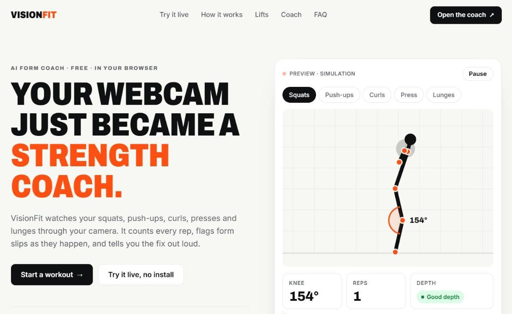
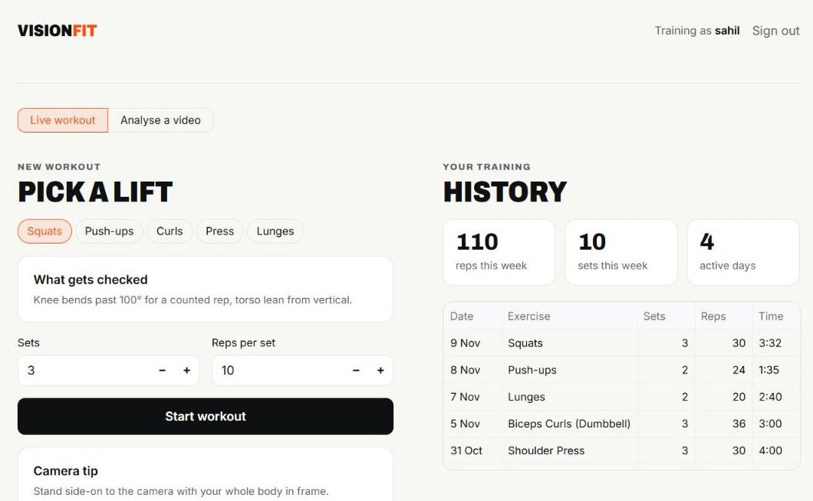
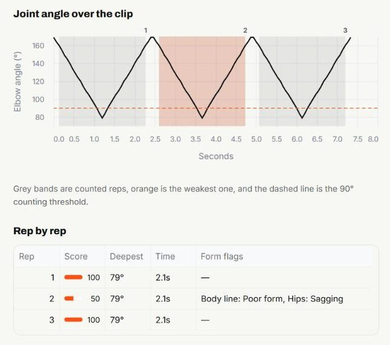
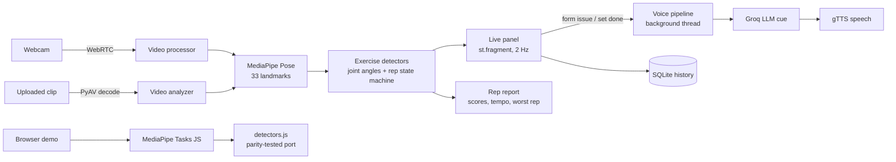

# VisionFit

**Your webcam is your strength coach.** VisionFit tracks your body through a camera, counts your reps, checks your form on five lifts, and tells you out loud what to fix.

[](https://github.com/SAHIL-AGARWAL-IN/VisionFit-/actions/workflows/tests.yml)


**[Try it live in your browser →](https://vision-fit-zeta.vercel.app/#live)** &nbsp;·&nbsp; **[Open the full coach app →](https://kfqb7msiivnxubjezjte7p.streamlit.app/)**

<sub>The coach app is hosted on Streamlit Community Cloud and can take ~30 s to wake up on the first visit. The browser demo starts instantly.</sub>



---

## What it does

| | |
| :--- | :--- |
| 🎥 **Live coaching** | Stream your webcam, pick a lift and a target, and get a live rep counter, set progress, form status and spoken cues. Supports squats, push-ups, biceps curls, shoulder press and lunges. |
| 🎬 **Video analysis** | Upload a workout clip. You get the video back with the skeleton drawn on, a joint-angle chart with every rep marked, a 0–100 score per rep, and the rep that needs the most work. |
| 🌐 **Runs in the browser** | The landing page runs pose tracking entirely on the visitor's device, with no upload and no server. It uses a JavaScript port of the same detectors, tested against the Python originals. |
| 📈 **History** | Finished sets are saved with reps and time, plus "this week" totals. |

<table>
  <tr>
    <td width="58%"></td>
    <td width="42%"></td>
  </tr>
  <tr>
    <td><sub>Pick a lift, set a target, see your week.</sub></td>
    <td><sub>Video analysis report (shown here with synthetic test data).</sub></td>
  </tr>
</table>

---

## How it works



1. **Pose.** MediaPipe's pose landmarker finds 33 body points in every frame.
2. **Detectors.** Each exercise has a small detector (`app/detectors/`) that computes the relevant 2D joint angles. It runs a rep state machine and reports form statuses such as `SAGGING`, `SWINGING` or `TOO HIGH`.
3. **Coaching.** When a status signals a problem, the voice pipeline asks a Groq-hosted LLM for a short, specific cue and turns it into speech. Without an API key it falls back to built-in cues.
4. **Reports.** For uploaded videos, the per-frame results are split into reps and scored.

---

## Engineering highlights

**Rep counting that judges the whole rep.**
The squat detector tracks the deepest knee angle of each rep. A rep counts only if the knee passed 100° before you stand back up past 160°. A shallow rep is flagged `TOO HIGH` and not counted. This replaced an earlier version with an inverted warning: it told people with good depth that they were too shallow, and never caught a really shallow squat. A regression test now guards against it.

**Explainable per-rep scores.**
`score = 100 − 50 × (share of rep frames with a form flag) − 10 if the counting angle was barely reached − 10 if the rep took under 1 s`.
Reps are split exactly where the detector's counter goes up, so the report always agrees with the live counter.

**The same logic in two languages, proven equal.**
`LandingPage/detectors.js` is a line-for-line port of the Python detectors. Both test suites run on one shared set of synthetic pose sequences generated from known joint angles. These cover clean reps, shallow squats, sagging hips, torso swing, back arch, lost balance and low visibility. The JavaScript output must match the Python output frame by frame.

**A UI that doesn't freeze.**
The live panel refreshes inside an `st.fragment` instead of rerunning the whole page. LLM and text-to-speech calls run on a background worker thread. Cues are rate-limited (5 s between cues, 15 s before repeating the same correction), so you hear coaching rather than a running commentary.

**Video pipeline.**
Clips are decoded with PyAV, resized to 720 px, run through the same pose model and detectors, and re-encoded as H.264 so they play in any browser. The analyzer records per-frame inference time and reports p50/p95 latency.

---

## Run it locally

Requires **Python 3.12** and a webcam. A free [Groq API key](https://console.groq.com/keys) is optional; without one the coach uses built-in cues.

```bash
git clone https://github.com/SAHIL-AGARWAL-IN/VisionFit-.git
cd VisionFit-

python -m venv venv
# Windows: .\venv\Scripts\activate   |   macOS/Linux: source venv/bin/activate
pip install -r requirements.txt
python -m streamlit run app/main.py
```

Optional: for AI-written cues, create a `.env` file in the repo root containing `GROQ_API_KEY=your_key_here`.

Open http://localhost:8501.

> **"No module named streamlit_webrtc"?** Your terminal is using a different Python, often Anaconda's. Run the venv's Python directly, for example `.\venv\Scripts\python.exe -m streamlit run app/main.py`.

**Landing page:** it's plain HTML/CSS/JS with no build step.

```bash
cd LandingPage && python -m http.server 8000
```

---

## Tests

```bash
pip install -r requirements-dev.txt
python -m pytest                           # 62 tests: detectors, rep report, voice pipeline, video pipeline
node --test tests/js/detectors.test.mjs    # 22 tests: browser detectors match Python frame by frame
```

CI (`.github/workflows/tests.yml`) runs both suites on every push. It also checks that the shared fixtures in `tests/fixtures/` are up to date.

**Real-world accuracy.** `scripts/benchmark.py` runs the full pipeline on hand-labelled clips. It reports the exact-match rate, rep-level accuracy, mean absolute error and pose-model latency. See [`benchmarks/README.md`](benchmarks/README.md) for how to record and label clips.

---

## Deploy

**Coach app: Streamlit Community Cloud**
1. Create a new app from this repo, with main file `app/main.py`.
2. Optionally add `GROQ_API_KEY` under *Settings → Secrets*.
3. For strict networks, add TURN/STUN servers as `[rtc_configuration]` in secrets.

**Coach app: Docker**

```bash
docker build -t visionfit .
docker run -p 8501:8501 -e GROQ_API_KEY=your_key_here visionfit
```

**Landing page:** point Vercel or any static host at the `LandingPage/` folder. The camera demo needs HTTPS.

| Variable | Required | Default | Purpose |
| :--- | :---: | :--- | :--- |
| `GROQ_API_KEY` | No | — | AI-written coaching cues (built-in cues are used without it) |
| `GROQ_MODEL` | No | `openai/gpt-oss-20b` | Groq model for cues |

---

## Project structure

```text
app/
├── main.py                  # Streamlit entry point
├── detectors/               # One detector per exercise (angles, rep state machine, form statuses)
├── services/
│   ├── analysis/            # Video analyzer + per-rep scoring report
│   ├── coaching/            # Groq LLM cues, text-to-speech, background voice pipeline
│   ├── tracking/            # Live metric sync, set counting, saving history
│   ├── vision/              # WebRTC frame processor, shared pose model + drawing
│   ├── ui/                  # Screens, HTML components, styling
│   └── ...                  # auth, config, persistence, session state
├── ml_models/               # MediaPipe pose landmarker model
└── samples/                 # Optional demo clips for "Try the sample clip"
LandingPage/                 # Static site: index.html, app.js (simulator), live.js, detectors.js
tests/                       # pytest suite, JS parity tests, shared pose fixtures
scripts/benchmark.py         # Accuracy benchmark on labelled clips
.streamlit/config.toml       # Theme, fonts and upload limits
```

---

## Limitations

- **Single camera, 2D angles.** Camera placement matters. Side-on with your whole body in frame works best.
- **History on Streamlit Cloud isn't permanent.** It lives in a local SQLite file that resets when the cloud app restarts.
- **Sign-in is name only.** It's a demo convenience, not authentication.
- **It's a training aid, not medical advice.**

---

Built by **Sahil Agarwal** · [LinkedIn](https://www.linkedin.com/in/sahil-agarwal-1761a8317) · [sahilagg2006@gmail.com](mailto:sahilagg2006@gmail.com)
